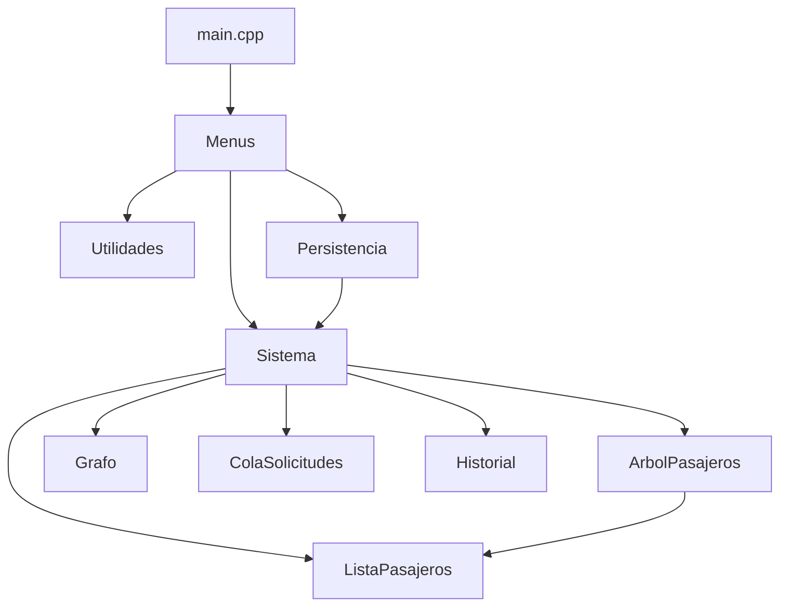

# SITRAC – Sistema Inteligente de Transporte y Gestión de Rutas

Proyecto de Estructura de Datos (C++) · USTA · 2026-II.

**Integrantes:** Rafael Tirado · Sofía _(completar apellido)_

Aplicación de consola con operaciones reales sobre memoria. Las estructuras
centrales están **implementadas desde cero** (nodos, punteros y enlaces propios):
no se usa `std::list`, `std::queue`, `std::stack`, `std::vector` ni `std::map`
para guardar los datos del sistema.

## Compilar y ejecutar

Requiere un compilador con C++11 (g++ de MinGW/MSYS2 o similar).

```bash
g++ -std=c++11 -Wall -Wextra -static -o sitrac.exe src/*.cpp
./sitrac.exe
```

En Windows también sirve `compilar.bat`. Compila con **0 errores y 0 advertencias**.

## Pruebas (20 pruebas reproducibles)

```bash
powershell -ExecutionPolicy Bypass -File tests/pruebas.ps1
```

El script le teclea entradas al programa real, verifica lo que responde y deja el
registro completo en `tests/resultados.txt`. Cubre: los 6 casos de la guía
(ciudad duplicada, pasajero inexistente, cola vacía, distancia negativa, ciudad
conectada eliminada, letras en campo numérico), ID duplicado, ruta inexistente,
ABB (recorridos, altura y borrado con dos hijos), BFS, DFS, Dijkstra, deshacer,
guardar/cargar, archivo corrupto, archivo con basura, archivo faltante, opciones
inválidas y fin de entrada. Ver `docs/EVIDENCIAS.md`.

## Menú principal

```
1 Gestión de ciudades      6 Árbol de búsquedas (ABB)
2 Gestión de conexiones    7 Rutas y algoritmos (BFS, DFS, Dijkstra)
3 Gestión de pasajeros     8 Reportes
4 Cola de solicitudes      9 Guardar / cargar
5 Pila de historial        0 Salir
```

Todos los submenús tienen **Volver** y el programa no termina por una operación fallida.

## Estructura del repositorio

```
src/
  main.cpp               punto de entrada: crea el Sistema y abre el menú
  Menus.h/.cpp           interfaz de consola (pide datos, llama a las estructuras, muestra resultados)
  Sistema.h/.cpp         reúne las 5 estructuras y mantiene lista + ABB sincronizados
  ListaPasajeros.h/.cpp  lista enlazada            (CRUD de pasajeros)
  ArbolPasajeros.h/.cpp  árbol binario de búsqueda (insertar, buscar, eliminar, recorridos)
  ColaSolicitudes.h/.cpp cola enlazada FIFO        (solicitudes de viaje)
  Historial.h/.cpp       pila enlazada LIFO        (viajes atendidos y deshacer)
  Grafo.h/.cpp           grafo con lista de adyacencia (ciudades, conexiones, BFS, DFS, Dijkstra)
  Persistencia.h/.cpp    guardar / cargar en archivo de texto con validación
  Utilidades.h/.cpp      lectura segura de entradas y funciones de texto
tests/pruebas.ps1        20 pruebas automáticas      tests/resultados.txt  registro de la última ejecución
docs/GUIA_EXPLICADA.md   el código explicado desde cero (para estudiar y sustentar)
docs/EVIDENCIAS.md       evidencias de ejecución
```

## Diagrama modular



`Menus` solo interactúa con el usuario. Las reglas (duplicados, distancia válida,
cola vacía…) viven dentro de cada estructura, y `Sistema` es el único que toca
varias estructuras a la vez.

## Estructuras de datos: operación → estructura → justificación

| Operación | Estructura | Justificación |
|---|---|---|
| CRUD de pasajeros | **Lista simplemente enlazada** | Se agrega y quita sin reservar tamaño ni desplazar elementos. Buscar es O(n). |
| Buscar pasajero por ID, recorridos ordenados | **ABB** (ordenado por ID) | Buscar descarta la mitad del árbol en cada paso: O(log n) si está equilibrado. Inorden entrega los pasajeros ordenados sin ordenar nada. |
| Solicitudes de viaje | **Cola enlazada** (`frente` y `fin`) | Se atiende por orden de llegada (FIFO); encolar y atender son O(1). |
| Historial y deshacer | **Pila enlazada** | Lo último que se atendió es lo primero que se ve o se deshace (LIFO); apilar y desapilar son O(1). |
| Ciudades y conexiones | **Grafo no dirigido ponderado, lista de adyacencia** | El mapa es disperso: usa O(V+E) de memoria (una matriz usaría O(V²)) y listar vecinos cuesta O(grado). |
| Alcance por niveles / exploración | **BFS** (cola) / **DFS** (recursión) | Ambos O(V+E). BFS entrega los niveles de alcance; DFS explora hasta el fondo. |
| Ruta más corta | **Dijkstra** con arreglos | Distancias siempre > 0. O(V²), suficiente para este tamaño. |

**Invariante de pasajeros:** la lista y el ABB siempre contienen los mismos
pasajeros. `Sistema` es la única puerta para agregar, actualizar o quitar
pasajeros, y por eso nunca quedan desincronizados.

## Complejidad (Big O)

`n` = pasajeros, `V` = ciudades, `E` = conexiones, `g` = vecinos de una ciudad.
También se puede ver en el programa: Reportes → opción 3.

| Operación | Costo |
|---|---|
| Insertar pasajero en la lista (revisa duplicados) / buscar / actualizar / eliminar | O(n) |
| ABB: insertar / buscar / eliminar | O(log n) equilibrado · O(n) peor caso |
| ABB: recorridos | O(n) |
| Cola: encolar / atender / ver frente · Pila: apilar / desapilar / ver tope | O(1) |
| Agregar ciudad (revisa duplicados) | O(V) |
| Agregar / eliminar conexión | O(V + g) |
| Eliminar ciudad (quita sus conexiones en todas las demás) | O(V + E) |
| BFS y DFS | O(V + E) |
| Dijkstra con arreglos | O(V²) |

## Reglas de integridad

- **Ciudad repetida** (sin distinguir mayúsculas): se rechaza, no se crea nodo.
- **ID de pasajero duplicado**: se rechaza.
- **Distancia ≤ 0 o no numérica**: se rechaza.
- **Eliminar ciudad**: borra también las conexiones que llegan a ella (sin referencias colgantes). Si hay solicitudes en cola que la usan, no se permite.
- **Eliminar pasajero**: sale de la lista y del ABB, y se retiran sus solicitudes de la cola.
- **Encolar**: exige pasajero existente, ciudades existentes y distintas, y que haya camino entre ellas.
- **Cola o historial vacíos**: atender, ver frente y deshacer informan en vez de fallar.
- **Deshacer**: devuelve el último viaje atendido al **frente** de la cola; si el pasajero o una ciudad ya no existen, lo informa y no pierde datos.
- **Entradas erróneas** (letras donde va un número, vacío, fuera de rango): se informa y se vuelve al menú; nunca hay ciclo infinito.
- **Persistencia**: se valida el archivo completo en un sistema temporal; solo si todo es correcto reemplaza los datos actuales. Archivo faltante o corrupto → mensaje con la línea del error y los datos actuales no cambian.

Formato del archivo (`sitrac_datos.txt`, campos separados por `|`):

```
SITRAC|1
C|ciudad                      R|ciudadA|ciudadB|km          P|id|nombre|edad
Q|idPasajero|origen|destino   H|idPasajero|nombre|origen|destino
```

## Limitaciones conocidas

- El ABB **no se auto-equilibra**: si los IDs llegan ya ordenados (1, 2, 3, …) se vuelve una lista y sus operaciones pasan a O(n).
- Las funciones del ABB son recursivas: un árbol degenerado de decenas de miles de nodos podría agotar la pila.
- Dijkstra usa arreglos (O(V²)); con muchísimas ciudades convendría una cola de prioridad.
- El grafo es no dirigido y solo guarda distancia (no tiempos ni costos).
- Las comparaciones sin distinguir mayúsculas solo cubren letras ASCII (`Bogotá` y `BOGOTÁ` serían ciudades distintas).
- Una solicitud ya encolada no se revalida si luego se elimina la conexión que la hacía posible.
- Deshacer solo cubre la última atención de la cola (no cualquier acción del sistema).
- Nombres: máximo 40 caracteres y sin el símbolo `|` (es el separador del archivo).

## Funcionalidades

| Funcionalidad | Estado | Responsable |
|---|---|---|
| Menú principal de 10 opciones y submenús con Volver | Terminada | _(completar)_ |
| Lista enlazada de pasajeros (CRUD + listar) | Terminada | _(completar)_ |
| Cola enlazada: encolar, atender, ver frente, mostrar | Terminada | _(completar)_ |
| Pila de historial y deshacer | Terminada | _(completar)_ |
| ABB: insertar, buscar, eliminar, 3 recorridos, altura | Terminada | _(completar)_ |
| Grafo: ciudades, conexiones, vecinos, integridad al borrar | Terminada | _(completar)_ |
| BFS, DFS y Dijkstra con reconstrucción de camino | Terminada | _(completar)_ |
| Reportes (resumen, conexiones, Big O) | Terminada | _(completar)_ |
| Guardar / cargar con validación | Terminada | _(completar)_ |
| Pruebas reproducibles (20) | Terminada | _(completar)_ |
| ABB auto-equilibrado (AVL) · Dijkstra con cola de prioridad | Pendiente | – |

## Declaración de uso de IA

- **Qué se consultó:** se usó Claude (Anthropic, vía Claude Code) para generar la
  primera versión del código a partir de la guía del taller (12-nov), para
  alinearlo con la presentación del proyecto (19-nov: ABB, BFS, DFS, deshacer y
  menú de 10 opciones), para simplificarlo, para escribir `docs/GUIA_EXPLICADA.md`
  y las pruebas de `tests/pruebas.ps1`.
- **Cómo se verificó:** compilación sin advertencias, las 20 pruebas del repositorio
  y una prueba de estrés aparte (miles de operaciones aleatorias comparadas contra
  una referencia, validación de integridad del grafo y conteo de memoria sin fugas).
- **Qué revisó y corrigió el equipo:** _(completar: qué leyeron, qué probaron en
  clase, qué cambiaron y por qué)_.
- Cada integrante debe poder explicar y modificar cualquier parte del código.
