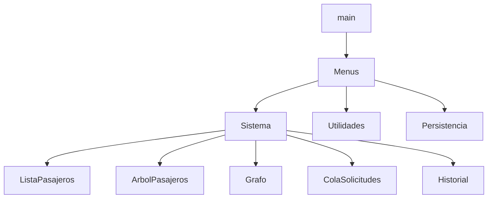

# Guía para entender y sustentar SITRAC (desde cero)

Esta guía asume que **no sabes nada** de punteros ni de estructuras de datos. Está
pensada para que tú y tu compañera entiendan el código línea por línea y puedan
responderle al profe. Léela en orden; cada parte se apoya en la anterior.

> **Regla de oro para la sustentación:** no memorices. El profe va a pedir
> (diapositiva 8) que cada uno **localice una función, modifique un comportamiento,
> justifique una decisión y haga commit**. Eso solo se logra entendiendo. Al final
> hay ejercicios (parte 7) para practicar exactamente eso.

## Índice

1. [Conceptos de cero](#1-conceptos-de-cero)
2. [Mapa del proyecto y cómo fluye un programa](#2-mapa-del-proyecto-y-cómo-fluye-un-programa)
3. [Las estructuras, una por una](#3-las-estructuras-una-por-una)
   - [3.1 Lista enlazada](#31-lista-enlazada-listapasajeros)
   - [3.2 Cola](#32-cola-colasolicitudes)
   - [3.3 Pila](#33-pila-historial)
   - [3.4 Árbol binario de búsqueda (ABB)](#34-árbol-binario-de-búsqueda-arbolpasajeros)
   - [3.5 Grafo](#35-grafo-ciudades-y-conexiones)
   - [3.6 BFS, DFS y Dijkstra](#36-bfs-dfs-y-dijkstra)
4. [Las piezas que unen todo](#4-las-piezas-que-unen-todo)
5. [Big O explicado simple](#5-big-o-explicado-simple)
6. [Preguntas típicas del profe y cómo responderlas](#6-preguntas-típicas-del-profe-y-cómo-responderlas)
7. [El "cambio sorpresa": ejercicios resueltos](#7-el-cambio-sorpresa-ejercicios-resueltos)
8. [Cómo repartirse la explicación y guion de la demo](#8-cómo-repartirse-la-explicación-y-guion-de-la-demo)
9. [Chuleta de comandos y glosario](#9-chuleta-de-comandos-y-glosario)

---

## 1. Conceptos de cero

### 1.1 La memoria es una fila de casilleros con dirección

Cuando creas una variable (`int edad = 20;`) la computadora reserva un casillero
en la memoria. Cada casillero tiene una **dirección** (como el número de un
apartamento). Un **puntero** es una variable que **guarda la dirección** de otro
casillero, no un valor normal.

```
 casillero (dirección 1000)         casillero (dirección 2000)
 ┌──────────────┐                   ┌──────────────┐
 │  edad = 20   │ ◄──────────────── │ p = 1000     │   p "apunta a" edad
 └──────────────┘                   └──────────────┘
```

Los símbolos que más vas a ver:

| Símbolo | Se lee | Ejemplo | Qué hace |
|---|---|---|---|
| `int* p` | "p es puntero a int" | `Ciudad* c;` | declara un puntero |
| `*p` | "lo que hay en p" | `*p = 5;` | va al casillero al que apunta |
| `p->campo` | "el campo de lo que apunta p" | `c->nombre` | igual que `(*c).nombre`; **es el que más se usa** |
| `&x` | "dirección de x" | `int* p = &x;` | obtiene la dirección |
| `nullptr` | "no apunta a nada" | `Ciudad* c = nullptr;` | puntero vacío; **nunca** se puede usar `c->`  con él |

Leer `a->destino->nombre` es: "de la arista `a`, ve a la ciudad destino, y toma su nombre".

### 1.2 `new` y `delete`: pedir y devolver memoria

- `new Ciudad` pide memoria **en el montón** (heap) para una ciudad y devuelve su dirección.
- `delete c` devuelve esa memoria. Si nunca haces `delete`, hay una **fuga de memoria**.
- `new int[10]` pide un arreglo; se devuelve con `delete[]` (con corchetes).
- Si haces `delete` y luego sigues usando el puntero, es un **puntero colgante**: apunta a memoria que ya no es tuya. Puede dar resultados raros o cerrar el programa. **Casi todo el cuidado de este proyecto es evitar eso.**

### 1.3 Nodo y enlace: la idea que sostiene todo el curso

Un **nodo** es una cajita con un dato y una flecha (puntero) al siguiente nodo.
Encadenando cajitas se forman las estructuras:

```
struct Nodo {                    cabeza
    int dato;                      │
    Nodo* sig;   ← la flecha       ▼
};                              ┌────┬───┐   ┌────┬───┐   ┌────┬─────┐
                                │ 10 │ ●─┼──►│ 20 │ ●─┼──►│ 30 │null │
                                └────┴───┘   └────┴───┘   └────┴─────┘
```

A diferencia de un arreglo, **no hay un tamaño fijo**: se agregan nodos con `new`
y se quitan con `delete`, cambiando flechas.

### 1.4 Estructura de datos = una forma de guardar + las reglas para usarla

| Estructura | Regla | Ejemplo de la vida real |
|---|---|---|
| **Lista** | se recorre de nodo en nodo | tren de vagones |
| **Cola (FIFO)** | el primero que entra es el primero que sale | fila del banco |
| **Pila (LIFO)** | el último que entra es el primero que sale | pila de platos |
| **Árbol binario de búsqueda** | menores a la izquierda, mayores a la derecha | diccionario: abres a la mitad y descartas media |
| **Grafo** | nodos conectados por aristas | mapa de ciudades y carreteras |

### 1.5 Cosas de C++ que aparecen en el código

- **`.h` y `.cpp`:** el `.h` (cabecera) dice **qué existe** (los nombres de las funciones); el `.cpp` dice **cómo funciona**. Es como el índice y el contenido de un libro.
- **`struct` y `class`:** agrupan datos (y funciones). `Pasajero` es un `struct` con `id`, `nombre`, `edad`.
- **Constructor / destructor:** el constructor (`ListaPasajeros()`) prepara el objeto al crearse; el destructor (`~ListaPasajeros()`) lo limpia al destruirse. Aquí el destructor llama a `vaciar()` para hacer `delete` de todos los nodos: así no hay fugas.
- **`const`:** promete "esto no se modifica". `bool buscar(...) const` = esta función solo mira.
- **Referencia `&`:** `void f(Pasajero& p)` trabaja con el original, no con una copia. `double& total` en `rutaMasCorta` es una "salida": la función llena esa variable.
- **`= delete` en el constructor de copia:** `ListaPasajeros(const ListaPasajeros&) = delete;` prohíbe copiar la lista. Si se copiara, dos listas apuntarían a los mismos nodos y al destruirlas se haría `delete` dos veces (error grave).
- **`static` en un `.cpp`:** una función `static` solo se ve dentro de ese archivo (es "privada del archivo").
- **`bool` que devuelve una función:** casi todas las operaciones devuelven `true` si funcionó y `false` si no (duplicado, no existe...). Así el menú decide qué mensaje mostrar.

---

## 2. Mapa del proyecto y cómo fluye un programa

### 2.1 Qué hace cada archivo

```
src/
  main.cpp               Solo 3 líneas: crea un Sistema y abre el menú. Nada de lógica aquí.
  Menus.cpp              Lo que ve el usuario: imprime menús, pide datos, muestra mensajes.
  Sistema.h / .cpp       Junta las 5 estructuras y las mantiene coherentes entre sí.
  ListaPasajeros         Lista enlazada de pasajeros.
  ArbolPasajeros         ABB de pasajeros (por ID).
  ColaSolicitudes        Cola de solicitudes de viaje.
  Historial              Pila de viajes atendidos.
  Grafo                  Ciudades, conexiones, BFS, DFS, Dijkstra.
  Persistencia           Guardar y cargar en un archivo de texto.
  Utilidades             Leer entradas sin que el programa se rompa.
```

Idea de diseño (esto es **modularidad**, y el profe la evalúa):
**`Menus` solo habla con el usuario; las estructuras solo guardan datos y aplican
sus reglas.** Ninguna estructura imprime menús, y `main()` no tiene lógica.



### 2.2 El programa siguiendo UN caso: "Agregar ciudad"

Entiende este recorrido y entenderás el 80 % del proyecto:

1. `main()` crea `Sistema sistema;` y llama `menuPrincipal(sistema)`.
2. `menuPrincipal` imprime las 10 opciones y llama `util::leerOpcion(...)`. El usuario escribe `1`.
3. El `switch` ejecuta `menuCiudades(sis)`, que imprime su submenú. El usuario escribe `1`.
4. Se ejecuta `ciudadAgregar(sis)` (en `Menus.cpp`): pide el nombre con `util::leerTexto`.
5. Llama a `sis.grafo.agregarCiudad(nombre)` (en `Grafo.cpp`).
6. `agregarCiudad` recorre la lista de ciudades; si ya existe una con ese nombre (sin distinguir mayúsculas) devuelve `false`. Si no, hace `new Ciudad`, la enlaza al final y devuelve `true`.
7. De vuelta en `ciudadAgregar`, según `true`/`false` imprime `[OK]` o `[!] ya existe`.
8. El `do ... while (op != 0)` vuelve a mostrar el submenú, hasta que el usuario elige `0` (Volver).

El patrón de **todos los menús** es el mismo:

```cpp
void menuCiudades(Sistema& sis) {
    int op;
    do {
        // imprimir las opciones
        op = util::leerOpcion("Opcion: ", 0, 3);   // devuelve la opción, -1 si fue inválida, 0 si se acabó la entrada
        switch (op) {
            case 1: ciudadAgregar(sis); break;
            case 2: ciudadEliminar(sis); break;
            case 3: sis.grafo.listarCiudades(); break;
            default: break;                          // 0 y -1 no hacen nada
        }
    } while (op != 0);                               // se repite hasta elegir Volver
}
```

Por eso "una opción inválida no cierra el programa": `leerOpcion` devuelve `-1`, el
`switch` no hace nada y el `while` vuelve a mostrar el menú.

### 2.3 Por qué se lee con `getline` y no con `cin >> numero`

Si usas `cin >> n` y el usuario escribe `hola`, `cin` entra en estado de error y
**todas las lecturas siguientes fallan sin esperar al usuario**: el menú se repite
sin parar (**ciclo infinito**). En `Utilidades.cpp` se hace distinto:

1. Se lee la **línea completa** como texto (`std::getline`).
2. Se convierte a número con `strtol`/`strtod` **revisando que toda la línea sea un número**.
3. Si no lo es, se informa y se devuelve `false`; el llamador cancela la operación y el menú sigue.

Esto resuelve el caso de prueba CP-06 ("letras donde se pide número").

---

## 3. Las estructuras, una por una

Para cada una: **idea → dibujo → código clave → por qué está bien hecho.**

### 3.1 Lista enlazada (`ListaPasajeros`)

**Para qué se usa:** guardar los pasajeros (insertar, buscar, actualizar, eliminar, listar).

```
cabeza ──► [ id=1 Ana ] ──► [ id=2 Luis ] ──► [ id=3 Zoe ] ──► nullptr
```

```cpp
struct NodoPasajero { Pasajero dato; NodoPasajero* sig; };   // el dato + la flecha
class ListaPasajeros { NodoPasajero* cabeza; int cantidad; ... };
```

**Insertar al final, rechazando duplicados** (un solo recorrido):

```cpp
bool ListaPasajeros::insertar(const Pasajero& p) {
    NodoPasajero* ultimo = nullptr;
    for (NodoPasajero* a = cabeza; a != nullptr; a = a->sig) {
        if (a->dato.id == p.id) return false;   // ID repetido: NO se crea ningún nodo
        ultimo = a;                              // recordar el último visto
    }
    NodoPasajero* nuevo = new NodoPasajero;      // recién aquí se pide memoria
    nuevo->dato = p;
    nuevo->sig = nullptr;                        // será el último
    if (ultimo == nullptr) cabeza = nuevo;       // la lista estaba vacía
    else ultimo->sig = nuevo;                    // enganchar al final
    ++cantidad;
    return true;
}
```

Fíjate: se comprueba el duplicado **antes** de hacer `new`; así nunca queda un nodo
de más (caso CP-01 / ID duplicado).

**Eliminar** (la parte que más se pregunta). Se usan dos punteros que caminan juntos:
`previo` (el de atrás) y `actual` (el que se quiere borrar):

```
Borrar id=2:     cabeza ─► [1] ─► [2] ─► [3]
                             ▲      ▲
                          previo  actual

   previo->sig = actual->sig   (el 1 salta al 3)   →   [1] ─► [3]      y luego  delete actual
```

```cpp
bool ListaPasajeros::eliminar(int id) {
    NodoPasajero* previo = nullptr;
    NodoPasajero* actual = cabeza;
    while (actual != nullptr && actual->dato.id != id) {   // buscar
        previo = actual;
        actual = actual->sig;
    }
    if (actual == nullptr) return false;       // no existe: la lista NO se toca (CP-02)
    if (previo == nullptr) cabeza = actual->sig;   // caso especial: era la cabeza
    else previo->sig = actual->sig;                // caso normal: saltarlo
    delete actual;                                  // liberar la memoria
    --cantidad;
    return true;
}
```

Dos casos que el profe puede preguntar: **borrar la cabeza** (`previo == nullptr`,
hay que mover `cabeza`) y **borrar un id que no existe** (`actual == nullptr`, no se
hace nada).

**Complejidad:** insertar (por revisar duplicados), buscar y eliminar recorren la lista: **O(n)**.

### 3.2 Cola (`ColaSolicitudes`)

**Para qué se usa:** las solicitudes de viaje, atendidas por orden de llegada (FIFO).

```
 salen por aquí                                     entran por aquí
      frente                                              fin
        │                                                  │
        ▼                                                  ▼
      [ Sol 1 ] ──► [ Sol 2 ] ──► [ Sol 3 ] ──► nullptr
```

Tiene **dos punteros** (`frente` y `fin`). Con `fin` encolar no necesita recorrer la
lista: es **O(1)**.

```cpp
void ColaSolicitudes::encolar(const Solicitud& s) {
    NodoSolicitud* nuevo = new NodoSolicitud;
    nuevo->dato = s;
    nuevo->sig = nullptr;
    if (fin == nullptr) frente = nuevo;   // cola vacía: el nodo es frente Y fin
    else fin->sig = nuevo;                // si no, se cuelga después del último
    fin = nuevo;                          // el nuevo pasa a ser el último
    ++cantidad;
}

bool ColaSolicitudes::atender(Solicitud& salida) {
    if (frente == nullptr) return false;      // cola vacía: subdesbordamiento controlado (CP-03)
    NodoSolicitud* sacar = frente;
    salida = sacar->dato;                     // entregar el dato
    frente = frente->sig;                     // el siguiente pasa a ser el frente
    if (frente == nullptr) fin = nullptr;     // ¡si quedó vacía, fin NO puede seguir apuntando!
    delete sacar;
    --cantidad;
    return true;
}
```

**La línea que más se olvida:** `if (frente == nullptr) fin = nullptr;`. Sin ella, al
vaciar la cola `fin` apuntaría a un nodo ya borrado (puntero colgante) y el siguiente
`encolar` escribiría en memoria liberada.

Otras dos funciones:

- `encolarAlFrente`: lo usa **deshacer**. Crea el nodo, lo apunta al antiguo frente y lo hace nuevo `frente`.
- `eliminarDePasajero(id)`: recorre la cola con `previo/actual` (igual que la lista) borrando todas las solicitudes de ese pasajero; si borra el último nodo, actualiza `fin`.

### 3.3 Pila (`Historial`)

**Para qué se usa:** guardar los viajes atendidos; el último atendido es lo primero que se ve o se deshace (LIFO).

```
  tope ──► [ viaje 3 (el más reciente) ] ──► [ viaje 2 ] ──► [ viaje 1 ] ──► nullptr
```

Solo se trabaja por **un extremo** (el tope):

```cpp
void Historial::apilar(const Viaje& v) {        // push
    NodoViaje* nuevo = new NodoViaje;
    nuevo->dato = v;
    nuevo->sig = tope;                           // el nuevo apunta al antiguo tope
    tope = nuevo;                                // y se vuelve el tope
    ++cantidad;
}

bool Historial::desapilar(Viaje& salida) {      // pop
    if (tope == nullptr) return false;           // pila vacía
    NodoViaje* sacar = tope;
    salida = sacar->dato;
    tope = tope->sig;                            // el siguiente pasa a ser el tope
    delete sacar;
    --cantidad;
    return true;
}
```

Las dos son **O(1)**: no hay que recorrer nada.

**¿Cómo funciona "Deshacer última atención"?** (`Sistema::deshacerUltimaAtencion`)

1. Mira el tope del historial (`verTope`). Si no hay → "nada que deshacer".
2. Comprueba que el pasajero y las ciudades **todavía existen**; si no, avisa y **no pierde nada**.
3. `desapilar` el viaje y lo mete con `encolarAlFrente` → vuelve a ser **el próximo en atenderse**.

Es decir: atender = *cola → pila*; deshacer = *pila → cola (al frente)*.

### 3.4 Árbol binario de búsqueda (`ArbolPasajeros`)

**La regla:** en cada nodo, todo lo de su **izquierda** tiene ID **menor** y todo lo de su
**derecha** tiene ID **mayor**. (Se insertan 50, 30, 70, 20, 40):

```
            50
          /    \
        30      70
       /  \
     20    40
```

**Buscar** = ir bajando y descartando la mitad: ¿id < nodo? izquierda; ¿mayor? derecha; ¿igual? encontrado.

```cpp
const Pasajero* ArbolPasajeros::buscar(int id) const {
    const NodoABB* actual = raiz;
    while (actual != nullptr) {
        if (id == actual->dato.id) return &actual->dato;       // encontrado
        actual = (id < actual->dato.id) ? actual->izq : actual->der;   // bajar
    }
    return nullptr;                                              // no existe
}
```

**Insertar** (recursivo). Se baja igual que al buscar hasta llegar a un hueco (`nullptr`) y ahí se crea el nodo:

```cpp
static NodoABB* insertarEn(NodoABB* nodo, const Pasajero& p, bool& insertado) {
    if (nodo == nullptr) { /* hueco: crear el nodo nuevo */ ... insertado = true; return nuevo; }
    if (p.id < nodo->dato.id)      nodo->izq = insertarEn(nodo->izq, p, insertado);
    else if (p.id > nodo->dato.id) nodo->der = insertarEn(nodo->der, p, insertado);
    else                           insertado = false;     // ID repetido
    return nodo;
}
```

*Cómo leer la recursión:* "para insertar en este árbol, inserta en el hijo correcto
y **reengancha** lo que devuelva". Cada llamada trabaja un subárbol más pequeño hasta
llegar al hueco.

**Eliminar: 3 casos** (es lo más difícil del ABB y lo más preguntado):

```
CASO 1 - HOJA (sin hijos): se borra y listo.

   borrar 20:     30              30
                 /  \     →         \
               20    40              40


CASO 2 - UN SOLO HIJO: el hijo ocupa el lugar de su padre.

   borrar 70      50                50
   (su único     /  \      →       /  \
   hijo es 80)  30   70          30    80
                       \
                        80


CASO 3 - DOS HIJOS: se busca el SUCESOR = el menor del lado derecho.
         Se COPIA su dato en el nodo y se borra el sucesor original
         (que a lo sumo tiene un hijo, así que es un caso 1 o 2).

   borrar 30      50                50
   (hijos 20    /    \     →      /    \
    y 40)     30      70       40      70      el sucesor de 30 es 40
             /  \             /
           20    40         20
```

```cpp
// Caso 3 en el código:
NodoABB* sucesor = nodo->der;
while (sucesor->izq != nullptr) sucesor = sucesor->izq;     // el menor del lado derecho
nodo->dato = sucesor->dato;                                 // copiar su dato aquí
nodo->der = eliminarEn(nodo->der, nodo->dato.id, borradoSucesor);   // borrar el sucesor original
```

¿Por qué el sucesor? Porque es el valor **más cercano por arriba**: ocupa el lugar sin
romper la regla "izquierda menor, derecha mayor".

**Recorridos** (cuándo se visita la raíz respecto a los hijos). Con el árbol de arriba:

| Recorrido | Orden | Resultado | Para qué sirve |
|---|---|---|---|
| **Inorden** | izquierda → raíz → derecha | 20 30 40 50 70 | **sale ordenado por ID** |
| **Preorden** | raíz → izquierda → derecha | 50 30 20 40 70 | copiar/guardar la forma del árbol |
| **Postorden** | izquierda → derecha → raíz | 20 40 30 70 50 | borrar el árbol (hijos antes que el padre) |

```cpp
static void inordenEn(const NodoABB* n, bool& primero) {
    if (n == nullptr) return;
    inordenEn(n->izq, primero);    // 1) todo lo menor
    imprimirNodo(n, primero);       // 2) yo
    inordenEn(n->der, primero);    // 3) todo lo mayor
}
```

**Altura:** `1 + max(altura izquierda, altura derecha)`; árbol vacío = 0.

**Complejidad:** buscar/insertar/eliminar son **O(log n)** si el árbol está equilibrado,
pero **O(n) en el peor caso**: si los IDs llegan ya ordenados (1, 2, 3, 4…) cada nodo
queda a la derecha del anterior y el árbol se vuelve una lista. La solución real
sería un árbol auto-equilibrado (AVL / rojo-negro); está declarada como limitación.

**¿Y por qué hay ABB y lista con los mismos pasajeros?** La lista es el CRUD simple
(O(n)); el ABB da búsqueda rápida y recorrido ordenado. Para que **nunca se
desincronicen**, solo `Sistema` agrega o quita pasajeros (`agregarPasajero`,
`quitarPasajero`, `actualizarPasajero`): cada una toca **las dos** estructuras.

### 3.5 Grafo: ciudades y conexiones

**Idea:** las ciudades son **vértices** y las carreteras son **aristas con peso** (km).

```
   Conexiones: A-B 4 km, A-C 1 km, B-D 1 km, C-D 5 km, D-E 3 km

          4          1          3
     A ────── B ────── D ────── E
     │                 │
   1 │                 │ 5
     └───── C ─────────┘
```

**Representación: lista de adyacencia.** Cada ciudad guarda **su propia lista** de
vecinos. En el código son **dos listas enlazadas**:

```
ciudades:   cabeza ─► [A] ─► [B] ─► [C] ─► [D] ─► [E] ─► nullptr
                       │      │      │      │      │
                       ▼      ▼      ▼      ▼      ▼
aristas de A:   ─► (B,4) ─► (C,1)
aristas de B:   ─► (A,4) ─► (D,1)
aristas de C:   ─► (A,1) ─► (D,5)
aristas de D:   ─► (B,1) ─► (C,5) ─► (E,3)
aristas de E:   ─► (D,3)
```

```cpp
struct Arista { Ciudad* destino; double distancia; Arista* sig; };
struct Ciudad { std::string nombre; Arista* aristas; Ciudad* sig; int indice; };
```

**¿Por qué lista de adyacencia y no matriz?** La matriz usa V×V casillas aunque
casi no haya carreteras (desperdicio) y listar vecinos recorre una fila entera. La
lista usa memoria proporcional a las conexiones reales: **O(V + E)**.

**¿Por qué cada conexión se guarda dos veces?** Es un grafo **no dirigido**: si A
conecta con B, B conecta con A. Entonces `agregarConexion` crea dos aristas: A→B y B→A.

```cpp
ResultadoRuta Grafo::agregarConexion(const std::string& a, const std::string& b, double distancia) {
    Ciudad* ca = buscarMutable(a);
    Ciudad* cb = buscarMutable(b);
    if (ca == nullptr || cb == nullptr) return RUTA_CIUDAD_INEXISTENTE;
    if (ca == cb) return RUTA_MISMA_CIUDAD;
    if (!std::isfinite(distancia) || distancia <= 0) return RUTA_DISTANCIA_INVALIDA;   // CP-04
    if (buscarArista(ca, cb) != nullptr) return RUTA_YA_EXISTE;
    insertarArista(ca, cb, distancia);       // A -> B
    insertarArista(cb, ca, distancia);       // B -> A
    return RUTA_OK;
}
```

Las validaciones van **antes** de crear nada: si algo falla, el grafo queda intacto.

**Eliminar una ciudad (CP-05) — el caso más importante de integridad:**

```cpp
// 1) En las DEMÁS ciudades, quitar toda arista que apunte a 'objetivo'.
for (Ciudad* c = cabeza; c != nullptr; c = c->sig)
    if (c != objetivo && quitarArista(c, objetivo)) ++conexionesEliminadas;
// 2) Liberar las aristas propias de 'objetivo'.
// 3) Sacar la ciudad de la lista y hacer delete.
```

¿Por qué el paso 1? Si borraras la ciudad B y A todavía tuviera una arista hacia B,
esa arista apuntaría a memoria liberada: **referencia colgante**. Recorrer el grafo
después podría cerrar el programa. Por eso se limpia **antes** de hacer `delete`.

**El campo `indice`:** BFS, DFS y Dijkstra necesitan arreglos auxiliares
(`visitada[]`, `dist[]`). Para saber qué posición del arreglo le toca a cada ciudad,
`numerar()` le pone a cada ciudad un número 0, 1, 2… en `indice`. Así, dada una arista,
`a->destino->indice` da la posición en **O(1)**.

### 3.6 BFS, DFS y Dijkstra

Usa de ejemplo el grafo del dibujo (A-B 4, A-C 1, B-D 1, C-D 5, D-E 3; los vecinos
salen en el orden en que se crearon las conexiones).

#### BFS — recorrido en anchura (por niveles) — usa una **cola**

Idea: primero todos los que están a 1 paso, luego a 2 pasos, etc. (como una onda en el agua).

```
cola: [A]
saco A (nivel 0) → agrego B y C (nivel 1)          cola: [B, C]
saco B → sus vecinos A (ya visitada) y D (nuevo, nivel 2)   cola: [C, D]
saco C → A y D ya visitadas                        cola: [D]
saco D → B, C visitadas; E nuevo (nivel 3)         cola: [E]
saco E                                             cola: []
Orden de visita: A, B, C, D, E
```

```cpp
visitada[origen->indice] = true;  nivel[origen->indice] = 0;  cola[fin++] = origen->indice;
while (frente < fin) {
    int u = cola[frente++];                                  // atender el frente
    // imprimir "nivel X: ciudad"
    for (Arista* a = todas[u]->aristas; a != nullptr; a = a->sig) {
        int v = a->destino->indice;
        if (!visitada[v]) {                // solo se encola lo que nunca se vio
            visitada[v] = true;
            nivel[v] = nivel[u] + 1;
            cola[fin++] = v;
        }
    }
}
```

`visitada[]` es lo que evita ciclos infinitos (A→B→A→B…). Aplicación: **alcance por niveles**
("¿a cuántos saltos está cada ciudad?").

#### DFS — recorrido en profundidad — usa **recursión** (la pila de llamadas)

Idea: meterse lo más profundo posible por un camino; cuando no hay más, **retroceder**.

```
visito A → primer vecino no visitado: B
  visito B → vecino no visitado: D
    visito D → vecino no visitado: C
      visito C → sus vecinos (A, D) ya visitados → retrocedo
    vuelvo a D → siguiente vecino no visitado: E
      visito E → retrocedo
Orden de visita: A, B, D, C, E
```

```cpp
static void dfsDesde(Ciudad* u, bool* visitada, int profundidad, int& contador) {
    visitada[u->indice] = true;
    // imprimir u->nombre con sangría = profundidad
    for (Arista* a = u->aristas; a != nullptr; a = a->sig)
        if (!visitada[a->destino->indice])
            dfsDesde(a->destino, visitada, profundidad + 1, contador);   // se mete más hondo
}
```

Aplicación: explorar un **componente conexo** (todo lo alcanzable desde una ciudad). El programa
imprime `Ciudades alcanzadas: k de N`; si `k < N` hay ciudades desconectadas.

**BFS vs DFS:** mismo resultado de "qué es alcanzable", distinto orden. BFS usa **cola**
y da niveles (camino con menos saltos); DFS usa **pila/recursión** y explora hasta el fondo.
Ambos son **O(V + E)**.

#### Dijkstra — camino de menor distancia

Idea: ir "fijando" siempre la ciudad más cercana que aún no se ha fijado y ver si por
ella se llega más barato a sus vecinos (**relajar**). Con el mismo ejemplo, de A a E:

| Paso | Ciudad que se fija | dist A | dist B | dist C | dist D | dist E | Qué pasó |
|---|---|---|---|---|---|---|---|
| inicio | – | 0 | ∞ | ∞ | ∞ | ∞ | solo A tiene distancia |
| 1 | **A** (0) | 0 | 4 | 1 | ∞ | ∞ | llegar a B cuesta 4, a C cuesta 1 |
| 2 | **C** (1) | 0 | 4 | 1 | 6 | ∞ | por C a D: 1+5 = 6 |
| 3 | **B** (4) | 0 | 4 | 1 | **5** | ∞ | por B a D: 4+1 = 5 **< 6**, mejora |
| 4 | **D** (5) | 0 | 4 | 1 | 5 | 8 | por D a E: 5+3 = 8 |
| 5 | **E** (8) | 0 | 4 | 1 | 5 | 8 | fin |

**Reconstruir el camino:** el arreglo `previo[]` guarda "de quién vengo". Desde E hacia
atrás: E ← D ← B ← A. Se meten en una pila y al sacarlos salen en orden: `A -> B -> D -> E (8 km)`.

**¿Por qué no funciona con pesos negativos?** Dijkstra asume que una vez fijada una ciudad
su distancia ya es la mínima. Con un peso negativo podría aparecer después un camino más
barato y la suposición se rompe. Por eso el programa solo acepta distancias **> 0**.

**Complejidad:** con arreglos, elegir la ciudad más cercana recorre V ciudades, V veces → **O(V²)**.
Con una cola de prioridad (heap) bajaría a **O((V+E) log V)** (está en limitaciones).

---

## 4. Las piezas que unen todo

### 4.1 `Sistema` — el coordinador

```cpp
struct Sistema {
    ListaPasajeros pasajeros;  ArbolPasajeros arbol;  Grafo grafo;
    ColaSolicitudes cola;      Historial historial;
    bool agregarPasajero(...);  bool actualizarPasajero(...);
    bool quitarPasajero(int id, int& solicitudesRetiradas);
    ResultadoDeshacer deshacerUltimaAtencion(Viaje& viaje);
};
```

Es el **único lugar** que toca varias estructuras a la vez:

- `agregarPasajero`: inserta en la lista; **solo si funcionó** inserta en el ABB.
- `quitarPasajero`: elimina de la lista, del ABB **y** retira sus solicitudes de la cola (si no, la cola quedaría con un pasajero fantasma).
- `deshacerUltimaAtencion`: explicado en 3.3.

**Invariante** (palabra clave de la diapo 10): *"la lista y el ABB siempre tienen los
mismos pasajeros"*. Un invariante es algo que debe ser verdad **antes y después de
cada operación**. El reporte "Resumen general" muestra ambos conteos para que se vea.

### 4.2 Persistencia: guardar y cargar con integridad

El archivo es texto, una línea por dato, separado por `|`:

```
SITRAC|1                  ← encabezado (identifica el formato)
C|Bogota                  ← ciudad
R|Bogota|Medellin|415.5   ← conexión
P|7|Zoe|25                ← pasajero
Q|7|Bogota|Medellin       ← solicitud en cola (de frente a fin)
H|7|Zoe|Bogota|Medellin   ← viaje del historial (del más reciente al más antiguo)
```

**Guardar** recorre cada estructura y escribe líneas. (El ABB no se guarda: se
**reconstruye** al cargar, porque sale de los pasajeros.)

**Cargar es lo interesante** (criterio "resistir archivo faltante o corrupto"):

1. Si el archivo no se abre → error, nada cambia.
2. Se crea un `Sistema temp` **aparte** y se va llenando línea a línea, **validando todo**: ciudad repetida, distancia inválida, ID duplicado, solicitud que usa un pasajero o ciudad inexistente, campos de más o de menos…
3. Si **cualquier** línea falla → mensaje con el número de línea y **los datos actuales no se tocan**.
4. Solo si todo está bien se hace `intercambiar`: cada estructura cambia sus punteros internos por los de `temp`. Al terminar la función, `temp` (que ahora tiene los datos viejos) se destruye y libera la memoria.

Es el patrón "**construir aparte, validar, y recién entonces reemplazar**": nunca se
queda el sistema a medias.

### 4.3 `Utilidades`: entradas seguras

`leerOpcion`, `leerEntero`, `leerDecimal`, `leerTexto`: leen una línea, la validan y
**nunca** dejan el programa en bucle. Si se cierra la entrada (Ctrl+Z / archivo que
se acaba), `leerOpcion` devuelve `0` para que todos los menús terminen limpio.
`iguales` compara textos sin distinguir mayúsculas (por eso `bogota` y `Bogota` son la misma ciudad).

### 4.4 ¿Cómo se evitan las fugas de memoria?

- Cada estructura tiene destructor que llama a `vaciar()` (libera todos sus nodos).
- Cada `new` tiene su `delete` (cuando se elimina un nodo, se hace en la misma función).
- Los arreglos de BFS/DFS/Dijkstra se crean con `new[]` y se liberan con `delete[]` antes de salir.
- Se verificó contando cada `new` y `delete` en una prueba de estrés: **quedaron 0 bloques sin liberar**.

---

## 5. Big O explicado simple

**Big O describe cómo crece el trabajo cuando crecen los datos**, sin importar la velocidad del computador.

| Notación | Se lee | Ejemplo en el proyecto | Si los datos se multiplican por 1000… |
|---|---|---|---|
| **O(1)** | constante | encolar, atender, apilar, desapilar | el trabajo es el mismo |
| **O(log n)** | logarítmico | buscar en un ABB equilibrado | solo ~10 pasos más |
| **O(n)** | lineal | buscar en la lista, recorridos del ABB | 1000 veces más trabajo |
| **O(V + E)** | lineal en el grafo | BFS, DFS | proporcional al tamaño del grafo |
| **O(V²)** | cuadrático | Dijkstra con arreglos | 1.000.000 veces más |

Por qué cada cosa cuesta lo que cuesta (para justificarlo en voz alta):

- **Cola/pila O(1):** solo se toca un extremo con un puntero que ya se tiene; no se recorre nada.
- **Lista O(n):** para encontrar un ID hay que ir nodo por nodo desde la cabeza.
- **ABB O(log n):** cada comparación descarta **la mitad** del árbol. Pero si el árbol se desbalancea (IDs ordenados) cada paso descarta solo 1 nodo → O(n).
- **BFS/DFS O(V+E):** cada ciudad se visita una vez (V) y cada arista se mira una vez (E, dos veces en un grafo no dirigido, que sigue siendo O(E)).
- **Dijkstra O(V²):** V veces se busca el mínimo entre V ciudades.

La tabla completa también aparece dentro del programa: **Reportes → 3**.

---

## 6. Preguntas típicas del profe y cómo responderlas

Respuestas cortas, para decirlas con tus palabras.

**Lista, cola, pila**

1. **¿Por qué lista enlazada y no un arreglo?** Los pasajeros se agregan y quitan seguido; con nodos no hay que fijar tamaño ni desplazar elementos. El costo es que buscar es O(n).
2. **¿Qué pasa si elimino la cabeza de la lista?** `previo` es `nullptr`, así que se mueve `cabeza` al siguiente nodo antes de hacer `delete`.
3. **¿Para qué la cola tiene el puntero `fin`?** Para encolar en O(1) sin recorrer la cola.
4. **¿Qué pasa con `fin` cuando atiendo el último elemento?** Debe ponerse en `nullptr`; si no, quedaría apuntando a un nodo borrado.
5. **¿Diferencia entre pila y cola?** La cola saca lo más antiguo (FIFO, fila del banco); la pila saca lo más nuevo (LIFO, pila de platos).
6. **¿Qué pasa si atiendo con la cola vacía?** `atender` devuelve `false`; el menú muestra un mensaje. No se accede a ningún puntero nulo.
7. **¿Cómo funciona deshacer?** Saca el tope del historial y lo mete al frente de la cola; si el pasajero o las ciudades ya no existen, avisa y no pierde datos.

**ABB**

8. **¿Por qué hay un ABB si ya existe la lista?** La lista busca en O(n); el ABB en O(log n) si está equilibrado, y su inorden entrega los pasajeros ordenados por ID sin ordenar. El costo es duplicar los datos, por eso `Sistema` mantiene ambos sincronizados.
9. **¿Cómo eliminas un nodo con dos hijos?** Copio el sucesor inorden (el menor del subárbol derecho) en el nodo y borro el sucesor original, que tiene a lo sumo un hijo.
10. **¿Por qué el inorden sale ordenado?** Porque visita izquierda (menores), luego el nodo, luego derecha (mayores), y eso se cumple en cada subárbol.
11. **¿Qué pasa si inserto IDs ya ordenados?** El árbol se degenera en una lista: altura = n y todo pasa a O(n). Se arreglaría con un árbol AVL.
12. **¿Por qué el ABB rechaza IDs repetidos?** Porque el ID es la clave de búsqueda; con repetidos "buscar" sería ambiguo.
13. **¿Cuál es la altura de un árbol con un solo nodo? ¿y vacío?** 1 y 0.

**Grafo y algoritmos**

14. **¿Por qué lista de adyacencia y no matriz?** El mapa es disperso; la lista gasta O(V+E) y la matriz O(V²).
15. **¿Por qué cada conexión se guarda dos veces?** El grafo es no dirigido; así se consultan vecinos desde cualquiera de los dos extremos.
16. **¿Qué pasaría si borro una ciudad sin quitar las aristas que llegan a ella?** Otras ciudades quedarían con punteros colgantes; recorrerlas después puede cerrar el programa. Por eso `eliminarCiudad` primero limpia esas aristas.
17. **¿Qué estructura usa cada algoritmo?** BFS usa una cola y un arreglo `visitada`; DFS usa recursión (la pila de llamadas) y `visitada`; Dijkstra usa arreglos `dist`, `previo` y `definitiva`.
18. **¿Para qué sirve `visitada`?** Para no volver a una ciudad ya vista y evitar ciclos infinitos.
19. **¿Por qué Dijkstra no admite pesos negativos?** Porque asume que al fijar una ciudad su distancia ya es la mínima; un peso negativo podría mejorarla después.
20. **¿Complejidad de Dijkstra y cómo mejorarla?** O(V²) con arreglos; con una cola de prioridad (heap) sería O((V+E) log V).
21. **¿Qué es el campo `indice` de `Ciudad`?** Un número temporal 0..n-1 que asigna `numerar()` para poder usar arreglos y consultar la posición de una ciudad en O(1).

**Memoria, entradas y archivos**

22. **¿Cómo evitaste fugas de memoria?** Destructores que llaman a `vaciar()`, cada `new` con su `delete`, y los arreglos auxiliares con `delete[]`. Lo comprobé contando cada `new`/`delete` en una prueba: 0 bloques sin liberar.
23. **¿Por qué `= delete` en el constructor de copia?** Para que nadie copie una estructura: dos copias compartirían nodos y se haría `delete` dos veces.
24. **¿Por qué lees con `getline` y no con `cin >> n`?** Con letras, `cin` falla y entra en un ciclo infinito. Leo la línea como texto y la convierto revisando que sea un número entero.
25. **¿Qué pasa si el archivo está dañado?** `cargarSistema` valida todo en un `Sistema` temporal; si algo falla, informa la línea y los datos actuales no cambian.
26. **¿Qué hace `intercambiar`?** Cambia los punteros internos de dos estructuras. Así se "reemplaza" todo de golpe y el temporal libera los datos viejos al destruirse.
27. **¿Qué es un invariante?** Algo que debe cumplirse antes y después de cada operación; aquí, que lista y ABB tengan los mismos pasajeros.
28. **¿Por qué `Sistema` es el único que modifica pasajeros?** Para que lista y ABB no se desincronicen y para limpiar la cola al eliminar un pasajero.

**Diseño**

29. **¿Dónde está la modularidad?** Cada estructura en su par `.h/.cpp`; `Menus` solo interactúa con el usuario; `Sistema` coordina; `main()` no tiene lógica.
30. **¿Qué limitaciones tiene su proyecto?** ABB sin auto-equilibrio, Dijkstra O(V²), deshacer solo de la última atención, comparación de mayúsculas solo ASCII. (Están en el README: decirlas con honestidad **suma** puntos.)

---

## 7. El "cambio sorpresa": ejercicios resueltos

El profe puede pedir: *"localiza la función X, cambia su comportamiento, justifica y haz commit"*.
Práctica sugerida: **hagan cada ejercicio ustedes mismos antes de mirar la solución.**

### Dónde buscar según lo que te pidan

| Si te piden cambiar… | Ve a… |
|---|---|
| un texto, un mensaje o un límite de lo que se escribe | `src/Menus.cpp` (busca el texto con Ctrl+F) |
| cómo se inserta, busca o borra un pasajero en la lista | `src/ListaPasajeros.cpp` |
| cómo funciona la cola | `src/ColaSolicitudes.cpp` |
| el historial o deshacer | `src/Historial.cpp` y `Sistema.cpp` (`deshacerUltimaAtencion`) |
| el ABB (insertar, borrar, recorridos) | `src/ArbolPasajeros.cpp` |
| ciudades, conexiones, BFS, DFS, Dijkstra | `src/Grafo.cpp` |
| qué se guarda o valida al cargar | `src/Persistencia.cpp` |
| cómo se valida un número o texto | `src/Utilidades.cpp` |

### Ejercicio 1 (fácil): cambiar el límite de edad a 110

La edad máxima aparece en **tres** lugares; si cambias solo uno, queda inconsistente:
`pasajeroInsertar` y `pasajeroActualizar` en `Menus.cpp` (el texto `Edad (0-120)` y el `120` de `leerEntero`) y la validación `p.edad > 120` de `Persistencia.cpp`.
**Justificación:** el límite debe ser el mismo al escribir y al cargar un archivo.

### Ejercicio 2 (fácil): agregar al menú de la cola la opción "Cantidad de solicitudes"

En `menuCola` (`Menus.cpp`): agregar la línea `" 5. Cantidad de solicitudes\n"`, cambiar `leerOpcion("Opcion: ", 0, 4)` a `0, 5` y un caso:

```cpp
case 5: cout << "  Solicitudes en cola: " << sis.cola.tamano() << "\n"; break;
```

### Ejercicio 3 (medio): inorden **descendente** (de mayor a menor ID)

En `ArbolPasajeros.cpp`, función `inordenEn`: cambia el orden de las llamadas.

```cpp
static void inordenEn(const NodoABB* n, bool& primero) {
    if (n == nullptr) return;
    inordenEn(n->der, primero);     // primero lo MAYOR
    imprimirNodo(n, primero);
    inordenEn(n->izq, primero);     // al final lo menor
}
```
**Justificación:** el inorden normal es izquierda-raíz-derecha; invertirlo da el orden contrario.

### Ejercicio 4 (medio): mostrar el pasajero con el **mayor ID** del ABB

En `ArbolPasajeros.h` (dentro de `public:`) agrega `const Pasajero* mayor() const;` y en `ArbolPasajeros.cpp`:

```cpp
const Pasajero* ArbolPasajeros::mayor() const {
    if (raiz == nullptr) return nullptr;
    const NodoABB* actual = raiz;
    while (actual->der != nullptr) actual = actual->der;   // lo más a la derecha
    return &actual->dato;
}
```
Para verlo en el menú, agrega la opción en `menuArbol`. **Justificación:** en un ABB el mayor siempre está al final de la rama derecha; es O(altura), no hace falta recorrer todo.

### Ejercicio 5 (medio): contar las **hojas** del ABB (nodos sin hijos)

```cpp
// en ArbolPasajeros.cpp
static int hojasEn(const NodoABB* n) {
    if (n == nullptr) return 0;
    if (n->izq == nullptr && n->der == nullptr) return 1;   // es hoja
    return hojasEn(n->izq) + hojasEn(n->der);
}
int ArbolPasajeros::contarHojas() const { return hojasEn(raiz); }
```
(Declara `int contarHojas() const;` en el `.h`.) Con el árbol 50, 30, 70, 20, 40 da **3** (20, 40 y 70).

### Ejercicio 6 (medio): contar pasajeros menores de cierta edad (lista)

```cpp
// en ListaPasajeros.cpp  (declara int contarMenores(int limite) const; en el .h)
int ListaPasajeros::contarMenores(int limite) const {
    int total = 0;
    for (const NodoPasajero* a = cabeza; a != nullptr; a = a->sig)
        if (a->dato.edad < limite) ++total;
    return total;
}
```
Es el patrón básico de **recorrer una lista**: `for (a = cabeza; a != nullptr; a = a->sig)`.

> Los ejercicios 3, 4, 5 y 6 se probaron compilando y ejecutando: con pasajeros 50, 30, 70, 20, 40 y edades 15, 40, 17, 60, 8, dan mayor = 70, hojas = 3, menores de 18 = 3 y el inorden descendente `70, 50, 40, 30, 20`.

### Más ideas que pueden pedirte

- **"Que atender la cola vacía diga otra cosa"** → `colaAtender` en `Menus.cpp`.
- **"Que los vecinos salgan en orden inverso"** → `insertarArista` en `Grafo.cpp`: insertar al inicio en vez de al final cambia el orden de BFS/DFS (y por qué: los vecinos salen en el orden de la lista).
- **"Que el historial muestre solo los últimos 3"** → `Historial::mostrar`, cortar el ciclo con un contador.
- **"Que BFS pare en el nivel 2"** → en `recorridoBFS`, no encolar vecinos cuando `nivel[u] >= 2`.

### Cómo hacer commit del cambio (lo piden en la diapo 8)

Después de compilar y comprobar que funciona:

```bash
git status                       # ver qué archivos cambiaron
git add -A                       # preparar los cambios
git commit -m "Describe el cambio en una frase"
git push                         # subir a GitHub
```

Buenas prácticas: un commit por cambio, mensaje que diga **qué** y **por qué**,
y **compilar y probar antes** de hacer commit.

---

## 8. Cómo repartirse la explicación y guion de la demo

La diapo 2 dice **"una sola persona explicando todo" NO es suficiente**. Propuesta
(ajústenla como quieran, pero cada uno debe poder explicar *cualquier* parte):

| Persona A | Persona B |
|---|---|
| Parte 1 y 2: conceptos, `main`, menús, `Utilidades` | ABB (3.4) |
| Lista (3.1), cola (3.2), pila y deshacer (3.3) | Grafo (3.5) y algoritmos (3.6) |
| Preguntas 1–7 y 22–25 | Preguntas 8–21 y 26–30 |

### Guion de demo (7–8 minutos)

1. **Compilar desde el repositorio** (`g++ ...`) y mostrar que no hay advertencias.
2. **Pasajeros:** insertar 5 (IDs 50, 30, 70, 20, 40) y mostrar que un ID repetido se rechaza. Menú 3.
3. **ABB:** menú 6 → inorden (ordenado), preorden, postorden, altura; **eliminar 30** (dos hijos) y volver a mostrar inorden. Decir cuál sucesor se usó.
4. **Ciudades y conexiones:** crear 5 ciudades y las conexiones del ejemplo; mostrar un error: ciudad duplicada y distancia `-5`.
5. **Algoritmos:** menú 7 → BFS, DFS y Dijkstra desde A hacia E. Explicar el orden de BFS y por qué Dijkstra eligió `A → B → D → E`.
6. **Cola e historial:** encolar 2 solicitudes, atender, ver el historial, **deshacer** y mostrar que vuelve al frente. Atender con la cola vacía.
7. **Integridad:** eliminar una ciudad conectada (CP-05) y mostrar que no quedan conexiones. Escribir letras donde va un número (CP-06).
8. **Archivos:** guardar, salir, abrir de nuevo, cargar y mostrar el resumen. Intentar cargar un archivo dañado.
9. **Pruebas:** ejecutar `tests/pruebas.ps1` → "20 de 20 pruebas pasan".

---

## 9. Chuleta de comandos y glosario

### Comandos

```bash
# compilar
g++ -std=c++11 -Wall -Wextra -static -o sitrac.exe src/*.cpp
# ejecutar
./sitrac.exe
# pruebas automáticas
powershell -ExecutionPolicy Bypass -File tests/pruebas.ps1
# git
git status
git add -A
git commit -m "mensaje"
git push
git log --oneline
```

### Glosario

| Término | Significado simple |
|---|---|
| **Puntero** | variable que guarda la dirección de otra cosa |
| **`nullptr`** | puntero que no apunta a nada |
| **Nodo** | cajita con un dato y uno o más punteros a otros nodos |
| **Cabeza / frente / fin / tope / raíz** | el nodo "de entrada" de la lista / cola (sale) / cola (entra) / pila / árbol |
| **Enlace** | puntero de un nodo hacia otro |
| **Fuga de memoria** | memoria pedida con `new` que nunca se devuelve con `delete` |
| **Puntero / referencia colgante** | apunta a memoria que ya fue liberada |
| **FIFO / LIFO** | primero en entrar, primero en salir / último en entrar, primero en salir |
| **ABB** | árbol binario de búsqueda: izquierda menor, derecha mayor |
| **Hoja** | nodo del árbol sin hijos |
| **Sucesor inorden** | el menor valor del subárbol derecho |
| **Vértice / arista** | nodo del grafo (ciudad) / conexión entre dos nodos (carretera) |
| **Grafo no dirigido ponderado** | las conexiones van en ambos sentidos y tienen un valor (km) |
| **Lista de adyacencia** | cada vértice guarda la lista de sus vecinos |
| **BFS / DFS** | recorrido en anchura (por niveles, usa cola) / en profundidad (usa recursión) |
| **Dijkstra** | algoritmo del camino de menor distancia con pesos no negativos |
| **Relajar** | comprobar si pasar por una ciudad mejora la distancia a su vecino |
| **Componente conexo** | conjunto de ciudades alcanzables entre sí |
| **Invariante** | condición que debe cumplirse antes y después de cada operación |
| **Big O** | cómo crece el trabajo cuando crecen los datos |
| **TAD** | tipo abstracto de dato: qué operaciones tiene, sin importar cómo se implementa |
| **Modularidad** | dividir el programa en partes con una responsabilidad cada una |
